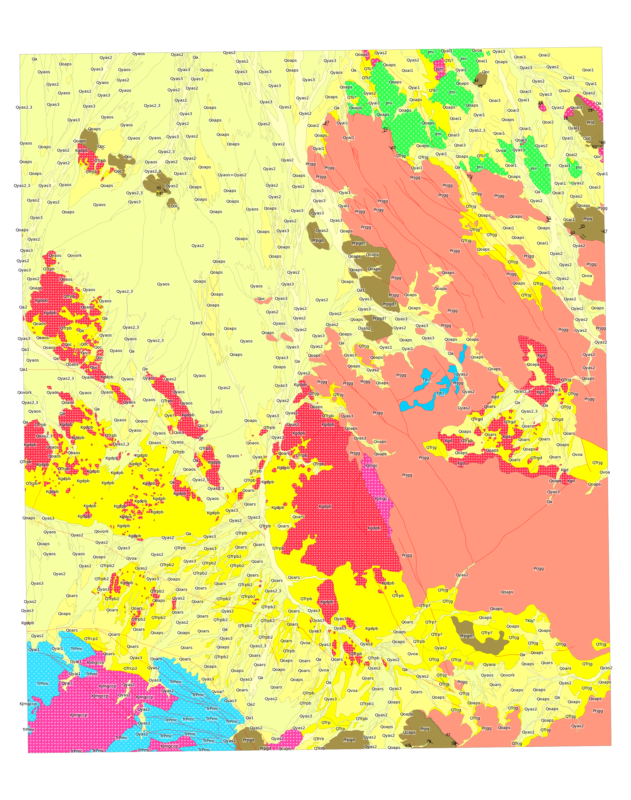

# mapgis2shp

[](https://pypi.org/project/mapgis2shp/)
[](https://www.python.org/downloads/)
[](LICENSE)

Read **and write** MapGIS 6.x/67 vector files (`.wt`, `.wl`, `.wp`) with [GeoPandas](https://geopandas.org/) GeoDataFrames.

MapGIS is a widely used closed-source GIS platform in China, especially in geological surveying, engineering, and scientific research. `pymapgis` provides a lightweight, open-source toolkit for reading, converting and writing its native point, line and polygon vector formats, parsing its graphic libraries, and rendering those vectors from the original libraries.

> **Relationship to prior work:** This package (`mapgis2shp`, import name `pymapgis`) is the matured, validated successor to the first author's earlier [`pymapgis`](https://github.com/leecugb/pymapgis) (2022) single-file reader — both developed by **Shijie Li** (leecugb). The present version adds coordinate-reference inference, vectorised parsing, polygon-topology reconstruction, and independent validation against the official MapGIS export.

## Contents

- [Installation](#installation) and [Quick start](#quick-start)
- [Command-line usage](#command-line-usage) and [Python API](#api)
- [Processing model](#processing-model-reader-writer-slib-and-geopdf)
- [Graphic libraries](#parsing-the-graphic-libraries)
- [Original-library rendering](#rendering-with-the-original-graphic-libraries)
- [USGS and research examples](#real-usgs-geological-map-conversion)
- [Supported formats](#supported-formats) and [technical documentation](#technical-documentation)
- [Development and tests](#development)
- [Release notes](#release-notes) and [further documentation](#further-documentation)

## Scope and boundaries

`mapgis2shp` has three deliberately bounded responsibilities:

1. **Vector interoperability** — read MapGIS 6.x/67 `.wt`, `.wl` and `.wp`
   files, convert them through GeoDataFrames/OGR, and write native vectors back
   with attributes, geometry, CRS and graphic parameters.
2. **Graphic-library parsing** — decode `Subgraph.lib`, `LINESTY.lib`,
   `Fillgrph.lib`, `Colorlib.lib` and `Pcolor.lib` structures without replacing
   them with per-map thematic rules.
3. **Original-library rendering** — render WP/WL/WT geometry using those
   libraries, including fills and patterns, line rhythms, point symbols,
   colours and attribute-derived labels.

The following are **outside the core package boundary**:

- Geological interpretation or calibration, contact/fault semantic classification,
  and GeoSciML conversion
- DZ/T or unit-specific thematic recolouring presented as native MapGIS output
- A general-purpose replacement for MapGIS editing, layout or native visual
  acceptance workflows

Attribute-derived polygon labels are a display convenience, not a geological
semantic conversion. Explicit colour override hooks remain available only for
clearly labelled comparison/thematic work. Native MapGIS display, editing and
save/reopen acceptance is separate from internal regression testing.

## Features

- Read **point** (`.wt`), **line** (`.wl`), and **polygon** (`.wp`) files
- **Write** GeoDataFrames back to native `.wt` / `.wl` / `.wp` binaries
- **Byte-preserving round-trips**: files written from a Reader's GeoDataFrame
  reuse source sections only when feature order, per-feature geometry and graphic
  parameters still match exactly. Reordered, regrouped or edited WT/WL/WP data are
  re-encoded instead of pairing new attributes with stale geometry. Reader → Writer →
  Reader regression verifies this internally; native MapGIS open/edit/save acceptance
  is a separate verification step
- **Native-structure writing**: written files carry the full 16-entry
  index table, the polygon label-box section (entry 11) and file footer
  (entry 12), the mm-to-degree display coefficients, and the header count
  sequence that MapGIS's renderer requires
- Decode GBK-encoded attribute fields and field names
- Decode point graphic parameters (text/symbol kind, subgraph number, glyph size, rotation angle, colour, layer, pen width / fonts)
- Decode line graphic parameters (style and auxiliary style numbers, line/auxiliary colour, width in mm, pattern coefficients, layer, transparent output)
- Decode polygon graphic parameters (class/layer, fill colour, pattern and pattern-colour numbers from the head_9 section)
- Parse the MapGIS 6.x graphic libraries themselves — `SubgraphLib` for
  `Subgraph.lib` point-symbol definitions (including chained records past
  the index table), `LinestyLib` for `LINESTY.lib` line-style definitions
  (sublines, element templates, dot/dash rhythm, pen tables), `ColorLib` for
  `Colorlib.lib` colour tables, `PcolorLib` for verified 32-byte `Pcolor.lib`
  colour nodes, and `FillgrphLib` for supported `Fillgrph.lib` fill-pattern
  records with explicit handling of unsupported structures
- Reconstruct polygon topology from arc records; preserve native sections on unchanged round-trips and encode freshly written polygons as independent closed rings with native ring-index pointers
- Preserve or repair invalid polygon geometries with `shapely.make_valid`
- Export to formats supported by GeoPandas/OGR (Shapefile, GeoJSON, GeoPackage, etc.; pyogrio is the declared runtime engine, while Fiona may be used when installed separately)
- Simple command-line interface for quick conversions in both directions

## Installation

```bash
pip install mapgis2shp
```

For original-library rendering and GeoPDF output, install the optional rendering
dependencies (Matplotlib and PyMuPDF):

```bash
pip install "mapgis2shp[render]"
```

The Python package is imported as `pymapgis`:

```python
from pymapgis import Reader
```

## Quick start

```python
from pymapgis import Reader
from pymapgis.testing import testdata_path

# No external survey data is needed: this is one of the seven bundled,
# USGS-derived MapGIS test layers.
with Reader(
    testdata_path("LDZOFBB001.WP"),
    read_graphic_params=True,
) as r:
    print(r)
    print(r.crs.to_epsg())                  # 32611
    print(r.coordinate_scale_factor)        # 1.0
    print(r.geodataframe[["QDUECC", "QDUECD"]].head())
    r.geodataframe.to_file("testdata_polygons.shp")
```

The seven processed test layers are real USGS Conejo Well derivatives, not
original NGAC/JWD vectors. Their native CRS is EPSG:32611 and coordinates are
in metres. The source map's 1:24,000 cartographic scale is independent of the
Reader coordinate multiplier.

## Public interface at a glance

The curated top-level API is defined by `pymapgis.__all__`:

| Responsibility | Public interfaces |
|---|---|
| Read / convert | `Reader`, `Reader.geodataframe`, `Reader.to_file()` |
| Write native vectors | `Writer`, `write()`, `WriterError` |
| Load graphic libraries | `GraphicLibraries.from_directory()` |
| Subgraph symbols | `SubgraphLib`, `SubPath`, `Symbol`, `symbol_geometries()`, `fit_circle()` |
| Line styles | `LinestyLib`, `LineStyle`, `SubLine`, `Element`, `compose_feature_style()`, `classify_form()`, `census()` |
| Fill patterns | `FillgrphLib`, `FillPattern`, `FillStroke`, `pattern_geometry()` |
| Colours | `ColorLib`, `PcolorLib` |
| Render WP / WL / WT | `GraphicRenderer`, `GraphicRenderResult`, `render_graphic_map()` |
| Projection / GeoPDF module APIs | `pymapgis.render_projection.prepare_render_layers()`, `pymapgis.geopdf.write_vector_geopdf()`, `inspect_geopdf()` |
| Bundled test data | `pymapgis.testing.fixture_path()`, `testdata_path()`, `usgs_conejo_path()`, `jwd_path()`, `slib_path()` |

Legacy research helpers remain available from their implementation modules for
compatibility, but are not all promoted to the curated top-level API. In
particular, geological semantic tables and classification helpers are not public
package responsibilities.

## Command-line usage

```bash
# Use the bundled seven-layer testdata in shell-based application examples.
# These two path-resolution commands require only the installed package.
TEST_WP="$(python -c "from pymapgis.testing import testdata_path; print(testdata_path('LDZOFBB001.WP'))")"
TEST_WT="$(python -c "from pymapgis.testing import testdata_path; print(testdata_path('LDZOFBA016.WT'))")"
SLIB_DIR="$(python -c "from pymapgis.testing import slib_path; print(slib_path())")"

# Convert bundled MapGIS data to common GIS formats.
pymapgis "$TEST_WP" testdata_polygons.shp
pymapgis "$TEST_WT" testdata_attitudes.geojson --driver GeoJSON

# Inspect the bundled, independently authorized generic graphic libraries.
pymapgis lib "$SLIB_DIR/Subgraph.lib" --symbol 1245
pymapgis lib "$SLIB_DIR/Colorlib.lib" --color 602
pymapgis lib "$SLIB_DIR/Pcolor.lib" --color 602

# Convert a polygon file to Shapefile
pymapgis input.wp output.shp

# Convert to GeoJSON
pymapgis input.wl output.geojson --driver GeoJSON

# Keep raw (possibly invalid) polygon geometries
pymapgis input.wp output.shp --no-make-valid

# Convert a Shapefile (or GeoJSON/GeoPackage) back to MapGIS
pymapgis input.shp output.wp
pymapgis input.geojson output.wl --encoding GBK

# Also decode graphic parameters (style/colour numbers, width, symbol
# number, angle, ...) into extra attribute columns
pymapgis input.wp output.gpkg --graphic-params

# Inspect any of the five supported graphic-library types
pymapgis lib Subgraph.lib                     # symbol counts (indexed + tail chain)
pymapgis lib Subgraph.lib --symbol 1960       # decode one symbol's geometry
pymapgis lib LINESTY.lib                      # whole-library census
pymapgis lib LINESTY.lib --style 211 --aux 0  # decode one line style
pymapgis lib Fillgrph.lib --pattern 220       # decode one fill pattern
pymapgis lib Colorlib.lib --color 602         # Colorlib channels and RGB
pymapgis lib Pcolor.lib --color 602           # Pcolor 32-byte node and RGB

# An installation with a verified alternate channel model can select it
pymapgis lib Colorlib.lib --color 602 --channel-order YMCK
```

The direction is chosen from the **input** extension: `.wt`/`.wl`/`.wp` input reads MapGIS; any other input writes MapGIS. The same interface is available as `python -m pymapgis input.wp output.shp`. CLI conversion preserves native polygon rings by default; pass `--make-valid` to repair them. Input and output must be different files—the CLI rejects identical paths and filesystem aliases instead of overwriting the source.

## API

### `Reader(filepath, make_valid=True, read_point_params=False, read_graphic_params=False)`

Main entry point for reading a MapGIS file. With `read_point_params=True`
(point files only), the per-point graphic parameter area is decoded as well:
the columns `point_type` (0 = text, 1 = symbol), `symbol_no`, `height`,
`width`, `spacing` and `angle` (degrees, counter-clockwise from east), plus
the shared tail `color` and `layer` and the kind-dependent `pen_width`
(symbol points) / `font_zh`, `font_en`, `font_style` (text points), are
appended to the GeoDataFrame and exposed separately as `point_params`.
With `read_graphic_params=True`, graphic parameters are decoded for any
file type — point parameters for `.wt` (as above), line parameters for
`.wl` (`linetype`, `aux_linetype`, `aux_flag`, `color`, `width`, `x_coef`,
`y_coef`, `aux_color`, `layer`, `transparent`, exposed as `line_params`),
and polygon parameters for `.wp` (`class`, `fill_color`, `pattern`,
`pattern_height`, `pattern_width`, `pattern_color`, `layer`, and the three
bytes `field5`/`field6`/`field7` forming the 24-bit ring-index offset,
exposed as `polygon_params`). Pattern dimensions are decoded from the uint16
high halves of float32 values stored in the head_9 section.

**Parsing and alignment invariants**

- The reader consumes all 16 physical section-index entries for every vector
  type. Raw non-empty sections and the file tail are retained in
  `geodataframe.attrs["mapgis_section_passthrough"]`; source field descriptors
  and record widths are retained in `geodataframe.attrs["mapgis_field_meta"]`
  for Writer round-trips
- Polygon IDs are collected from the topology table, but only IDs with a
  corresponding attribute row are emitted. The same filtered ID sequence drives
  attributes, geometries and polygon graphic parameters, so orphan topology IDs
  are dropped consistently instead of causing a pandas length mismatch
- Attribute/geometry count disagreement raises `MapGISError`. A graphic-parameter
  count disagreement emits a warning and drops that parameter group rather than
  joining values to the wrong features
- Invalid headers, negative or past-EOF section ranges, degenerate one-point arcs and
  topology tables longer than the arc index raise `MapGISError`. Declared section and
  attribute sizes are checked before bulk reads so malformed files cannot request
  memory beyond the available data. Empty input produces an empty GeoDataFrame and a
  zero bounding box

**Attributes**

| Attribute | Type | Description |
|-----------|------|-------------|
| `shapeType` | `str` | `"POINT"`, `"LINE"`, or `"POLYGON"` |
| `crs` | `pyproj.CRS` or `str` | Detected coordinate reference system; empty string when no valid CRS can be inferred |
| `bbox` | `numpy.ndarray` | Bounding box `[minx, miny, maxx, maxy]` |
| `fields` | `list[tuple]` | Field metadata: `(name, type_name, length)` |
| `data` | `pandas.DataFrame` | Attribute table |
| `geom` | `list[shapely.geometry]` | Geometry objects |
| `point_params` | `pandas.DataFrame` | Point graphic parameters (`.wt`, opt-in) |
| `line_params` | `pandas.DataFrame` | Line graphic parameters (`.wl`, opt-in) |
| `polygon_params` | `pandas.DataFrame` | Polygon graphic parameters (`.wp`, opt-in) |
| `geodataframe` | `geopandas.GeoDataFrame` | Combined attributes and geometry |

**Methods**

- `to_file(filepath, **kwargs)` — forward to `GeoDataFrame.to_file`
- `len(reader)` — number of features
- `str(reader)` — summary (`"n features (type POINT)"`); `repr(reader)` shows the constructor arguments
- Context manager: `with Reader(...) as r:` (the file is fully parsed and closed in the constructor)

### Constants

- `POINT_TYPE_TEXT` (0) / `POINT_TYPE_SYMBOL` (1) — values of the `point_type` column for `.wt` graphic parameters
- `pymapgis.__version__` — package version string

### Exceptions

- `MapGISError` — base exception
- `InvalidFileError` — unsupported or unrecognized file
- `TopoError` — polygon topology reconstruction error
- `InvalidDirectoryError` — reserved for project/directory errors
- `WriterError` — a GeoDataFrame cannot be encoded as a MapGIS file

### `Writer(geodataframe, *, make_valid=False, on_empty="error", map_scale=1000.0, preserve_utm=False, snap_tolerance=0.0, graphic_params=True, geometry_type=None)`

Encode a GeoDataFrame as a MapGIS binary file. One geometry type per file:
Point/MultiPoint for `.wt` (MultiPoint is exploded with a warning),
LineString/MultiLineString for `.wl` (exploded likewise), and
Polygon/MultiPolygon for `.wp` (a MultiPolygon stays one polygon feature,
matching the reader).

```python
from pymapgis import Reader, Writer
from pymapgis.testing import testdata_path

source = Reader(
    testdata_path("LDZOFBB001.WP"),
    read_graphic_params=True,
)

# Preserve the existing UTM metres and native parameter areas. map_scale=1000
# is a storage setting that makes Reader's coordinate multiplier 1.0; it is
# not the source map's 1:24,000 cartographic scale.
Writer(
    source.geodataframe,
    map_scale=1000,
    preserve_utm=True,
).to_file("testdata_roundtrip.wp")

# For another GeoDataFrame, the shortcut remains: write(gdf, "out.wp")
```

- `make_valid` — disabled by default to preserve native rings, duplicate
  vertices, holes and ring counts. Set it to `True` to repair invalid polygons
  explicitly before arc decomposition; repair may change the resulting rings
- `on_empty` — `"error"` (default) rejects empty/null geometries with their
  row positions; `"drop"` discards them with a warning only when explicitly
  requested
- `map_scale` — positive, finite map-scale denominator for projected CRS (coordinates are
  stored as `value * 1000 / map_scale`); ignored for longitude/latitude data
- `preserve_utm` — `False` by default, converting UTM to the same-datum
  Gauss–Krüger `tmerc + k=1` target. `True` keeps northern-hemisphere UTM
  coordinates and writes `k=0.9996` at offset 232. Southern-hemisphere UTM is
  rejected explicitly because false-northing preservation is not implemented.
- `snap_tolerance` — finite, non-negative coordinate quantisation step applied before topology
  validation and ring encoding (0 = exact coordinates, no snapping)
- `graphic_params` — when the frame carries the reader's graphic-parameter
  columns (`point_type`/`symbol_no`/..., `linetype`/...,
  `fill_color`/`pattern`/`pattern_height`/`pattern_width`/...), write them
  into the native parameter areas instead of the ordinary attribute table.
  A recognised key column activates a parameter group and missing columns
  receive native defaults. Polygon `field5`/`field6`/`field7` are computed
  ring-index offsets, not editable style defaults
- `geometry_type` — explicit `"POINT"`/`"LINE"`/`"POLYGON"` for empty frames; empty
  output uses finite zero header extents

Freshly written WP files encode every exterior and interior ring as an
independent closed arc, preserve consecutive duplicate vertices, and write
native polygon/ring/arc indices into the coordinate section. Each polygon's
24-bit ring-index offset is calculated during the same encoding pass so the
arc index, coordinate section and head_9 pointers stay consistent.

Attributes are encoded with MapGIS field types inferred from pandas dtypes
(GBK strings, dates, times, numbers). Unsupported or duplicate columns, invalid scale
or tolerance values, and signed-16-bit graphic-parameter overflow raise `WriterError`
instead of leaking low-level encoder exceptions.
A GeoDataFrame produced by `Reader` also carries source section bytes and field
metadata in `gdf.attrs`. `Writer` reuses those sections only when ordered feature
geometry and graphic parameters match exactly, including line grouping and every
vertex coordinate. Otherwise it re-encodes the changed data. Tested unchanged
round-trips preserve native record widths, metadata blocks, polygon label boxes and
file footers without hiding reordering or small edits.

**Write-side limitations**

- `.wt` label text stored in auxiliary annotation sections is not produced;
  written `.wt` files carry geometry, attributes, and symbol points only
- Shapefile's 10-character field-name limit truncates long parameter columns
  (e.g. `pattern_color` → `pattern_col`) when passing through `.shp`, which
  disables the matching parameter group on write; GeoJSON/GeoPackage or a
  direct GeoDataFrame hand-off is unaffected
- By default, UTM inputs are first reprojected to Gauss-Kruger (k=1) with the
  zone-derived central meridian, preserving the established native-output path.
  Use `Writer(..., preserve_utm=True)` to keep UTM coordinates unchanged and
  store `k=0.9996` at offset 232. Set `map_scale=1000` when a Reader coordinate
  scale factor of 1.0 is also required. Native MapGIS acceptance of non-unity
  `k` remains a separate validation step
- Longitude/latitude, Transverse Mercator, Albers, and Lambert CRS are
  written; other projections raise `WriterError`
- CGCS2000 has no MapGIS ellipsoid code and is written as WGS84 with a
  warning (they agree to better than 0.1 mm)
- Freshly authored polygon files (data that did not come from a `Reader`)
  use the native structural conventions (16-entry index, label-box and
  footer sections, closed-ring arcs), but arbitrary new data still needs
  native-application acceptance. Round-tripped files preserve source structure
  and are checked by internal Reader → Writer → Reader regression

## Processing model: Reader, Writer, SLIB and GeoPDF

The current pipeline has four separate stages. Keeping these stages explicit
avoids confusing file decoding, coordinate conversion, style interpretation and
page production.

### 1. Reader: native bytes to aligned GeoDataFrames

`Reader` first identifies the vector magic and then reads all 16 physical section
entries. Attribute descriptors and record widths are decoded before records are
joined to geometry. WP files additionally reconstruct the arc–ring–polygon
topology, including holes, and retain the 24-bit ring-index pointers. Non-empty
source sections, footer bytes, field metadata and coordinate metadata are kept
in `gdf.attrs` for loss-aware writing.

Alignment rules are strict: only topology IDs with matching attribute rows are
emitted, and the same filtered sequence drives attributes, geometry and native
parameters. Orphan IDs are not silently joined to the wrong features.
`make_valid=True` repairs reconstructed polygons by default; use `False` to keep
the raw rings. `read_graphic_params=True` decodes WP/WL parameters, and
`read_point_params=True` decodes WT parameters. Native parameters take
precedence when a DBF column and a native parameter have the same name.

CRS handling is metadata handling, not reprojection. The reader decodes
projection and ellipsoid indices, the header scale at byte 143 and the
Transverse-Mercator `k` at byte 232. The geometry multiplier is
`header_scale / 1000`, exposed as `coordinate_scale_factor` and
`gdf.attrs["mapgis_coordinate_scale_factor"]`. Thus 1:1000 means 1 MapGIS unit
= 1 ground metre, while `k=0.9996` is a projection parameter, not a paper-scale
denominator. `set_crs` declares a CRS; `to_crs` performs a coordinate operation.
Reader itself never performs that operation.

### 2. Writer: GeoDataFrames to native vectors

Writer accepts one geometry family per file. MultiPoint and MultiLineString are
exploded with warnings; a MultiPolygon remains one feature. `make_valid=False`
preserves source rings and duplicate vertices by default, while explicit repair
may change them. Empty/null rows follow `on_empty`; a validation result with no
polygonal geometry raises `WriterError` instead of leaking an encoding error.
Polygon `class` and `layer` are independent native parameters and are never
inferred from one another.

Fresh polygons are encoded as independent closed rings with arc, coordinate and
24-bit ring-index sections kept consistent. Reader-derived source sections are reused
only after exact ordered geometry and parameter comparison; any reordering, regrouping
or coordinate edit forces safe re-encoding. This distinction is why internal
round-trips can be byte-faithful without claiming that every newly authored file is
guaranteed to display identically in MapGIS.

For projected data, `map_scale=S` stores coordinates as `value * 1000 / S`, so
the file continues to use scaled paper millimetres. UTM input follows two
explicit paths: the default converts to the same-datum Gauss–Krüger target with
`k=1`; `preserve_utm=True` keeps northern-hemisphere coordinates and writes
`k=0.9996` at offset 232. Southern-hemisphere preservation is rejected rather
than silently misread. Longitude/latitude, Transverse Mercator, Albers and
Lambert are supported; other projections fail explicitly.

### 3. Graphic libraries: native indices to drawable geometry

| Library | Native role | Current interpretation |
|---|---|---|
| `Subgraph.lib` | WT symbols | Indexed and tail-chain records, subpaths, fills, circles and arcs, with truncated-record guards |
| `LINESTY.lib` | WL line styles | Subline templates and f32 rhythm payloads; actual pen intervals, offsets and source-chainage clipping |
| `Fillgrph.lib` | WP patterns | Fill polygons, polylines, circles and arcs, including per-stroke width arrays |
| `Colorlib.lib` | Line, point and pattern colours | Four-channel records with an explicit KCMY/YMCK installation model |
| `Pcolor.lib` | WP fill colours | 32-byte node `N + 3`, channel bytes at node offset 28; all-zero KCMY is valid white |

Only an exact solid-pen record uses the solid fast path. Partial, reversed or
offset single-pen records retain their stored intervals. Alternative non-solid
sublines are not merged, multiple solid pens remain overlays, and zero-offset
strokes follow the original vertices rather than chords between period
endpoints. Unsupported structures remain unresolved and are reported rather
than replaced by inferred geometry. WP fills use Pcolor in `auto` mode when it
is available; other colour roles continue to use Colorlib.

### 4. Rendering: native geometry and styles to a strict-scale GeoPDF

`prepare_render_layers()` resolves coordinates before drawing. An explicit
`--target-crs` wins. Otherwise, the combined non-empty bounds select one
6-degree Gauss–Krüger zone (3-degree zoning is optional), preserving the source
ellipsoid and `towgs84` values and reprojecting every layer to that one CRS.
Missing source CRS requires `--source-crs`, or an explicit
`--map-units-per-mm` for unprojected rendering without GeoPDF. Mixed datums,
antimeridian ambiguity, excessive spans and polar inputs require an explicit
target.

Graphic dimensions remain paper-relative, not ground-relative:

```text
1 MapGIS unit = 1 paper mm = scale_denominator / 1000 ground metres
paper_mm = ground_units × 1000 / scale_denominator
paper_pt = paper_mm × 72 / 25.4
```

The renderer's `_unit()` performs the millimetre-to-ground conversion for the
selected CRS. Fonts, line widths and collision offsets use points, and the
fallback dip tick uses `attitude_dip_tick_mm=2.0`. The requested DPI is used
when the Figure is created, so it affects text measurement and layout but not
the certified page scale.

Reports retain the WP → WL → WT order. In full-layout mode, native WT
annotations become fixed obstacles first, derived dip labels are placed next,
and WP/WL labels follow. Polygon candidates search in-polygon offsets with a
seed, buffer and maximum offset instead of deleting conflicts wholesale.
Native text-category filters apply only to text annotations, never to attitude
Subgraph points. Dip text comes from `dip`/`GZBBAD`; symbols 1245/1249 use the
actual SLIB short tick and other symbols use the native dip-direction field.
Independent native dip annotations are excluded when the derived form is
selected, preventing duplicates.

`write_vector_geopdf()` then computes the Axes dimensions from the ground
extent and requested denominator and embeds ISO 32000 `/VP`, `/Measure /GEO`,
`/GPTS`, `/LPTS` and `/GCS`. The standard entry independently recomputes X/Y
scale from the final page transform and fails on any mismatch or raster image
object. Ordinary tight-bbox PDF is intentionally not produced. The JSON report
includes each input's SHA-256, native CRS and header-scale values, plus final
text-collision and drawing statistics. PNG/SVG remain previews, not
scale-certified prints.

## Reading graphic parameters

Beyond geometry and attributes, MapGIS files carry per-feature **graphic
parameters** (how MapGIS draws the feature). Decoding is opt-in:

```python
from pymapgis import Reader, POINT_TYPE_SYMBOL

# Point files: annotation vs. subgraph symbol, symbol number, glyph size,
# rotation angle
with Reader("points.wt", read_graphic_params=True) as r:
    symbols = r.geodataframe[r.geodataframe.point_type == POINT_TYPE_SYMBOL]
    print(symbols[["symbol_no", "height", "width", "angle"]].head())

# Line files: style and auxiliary style numbers, colour index, width in
# millimetres, pattern coefficients
with Reader("lines.wl", read_graphic_params=True) as r:
    print(r.geodataframe[["linetype", "aux_linetype", "color",
                          "width", "x_coef", "y_coef"]].head())

# Polygon files: class/layer, fill colour, pattern number and dimensions,
# pattern colour, and the 24-bit ring-index pointer bytes
with Reader("polygons.wp", read_graphic_params=True) as r:
    print(r.geodataframe[["class", "fill_color", "pattern",
                          "pattern_height", "pattern_width", "pattern_color"]].head())
```

> **Warning — not self-contained.** Style, colour, symbol and pattern
> numbers are indices into the MapGIS system libraries (Slib, line-style
> library, pattern library) of the *originating* MapGIS installation; the
> glyph definitions are not stored in the data files. The same number may
> mean different things under a different or customised library. Field
> layouts were reverse-engineered and validated on the layers of map sheet
> J43C001002 — verify against your own data before relying on them.

## Parsing the graphic libraries

The library files referenced by the graphic parameters can be parsed
directly (the same parsers back the `pymapgis lib` subcommand):

```python
from pymapgis import (
    FillgrphLib, LinestyLib, SubgraphLib, PcolorLib,
    classify_form, compose_feature_style, pattern_geometry,
)

# Subgraph.lib: point-symbol geometry (mm coordinates, subpaths, fitted circles)
lib = SubgraphLib("Subgraph.lib")
print(lib.n_indexed, "indexed +", lib.n_tail, "tail-chain symbols")
sym = lib.decode(1960)          # None when out of range
for sp in sym.subpaths:
    print(len(sp.points), "points", sp.circle)   # circle = (cx, cy, r) fit

# LINESTY.lib: line styles (1-based, as stored in .wl linetype fields)
styles = LinestyLib("LINESTY.lib")
style = styles.decode(211)
print(classify_form(style))                        # form label + evidence
main, aux = compose_feature_style(styles, 211, 0)  # aux is None when it selects a main-record variant

# Fillgrph.lib: pattern records and data-driven geometry
patterns = FillgrphLib("Fillgrph.lib")
print(pattern_geometry(patterns, 220))

# Pcolor.lib: colour N is in 32-byte node N + 3, channels at node +28
pcolors = PcolorLib("Pcolor.lib")
print(pcolors.rgb(602))  # (255, 255, 178) in the verified JWD library
```

Line-style style numbers and symbol numbers are *library-local*: they
resolve only against the same (or a byte-identical) library that produced
the data.

For LINESTY, the renderer uses a hybrid path: previously verified `(linetype,
aux)` variants first resolve through `feature_rhythm()`, preserving their
validated period, phase and subline selection. Other records use
`LineStyle.rhythm()` when the library contains a direct rhythm, or the selected
subline's `SubLine.parameter_geometry()` otherwise. The structural path consumes
element templates and f32 payloads without consulting style numbers or
adjudication tables. Alternative non-solid sublines are not merged; multiple
solid pens remain genuine overlays. Explicit fill/dot units are honoured; an
unproven dot fill is `None` and is reported as `unknown_fill` instead of being
inferred from radius. A verified but unresolved variant stays unresolved rather
than being replaced by generic geometry. Raised-line variants such as `48|0`
use the library's actual segment intervals rather than screen-space dash
constants; source vertices are preserved on curved base lines, and `x_coef` /
`y_coef` scale longitudinal rhythm and transverse offset respectively.
Coincident solid dots in the verified 16/17 records are merged by their visible
union, retaining the largest radius without overplotting redundant references.
Zero-offset rhythm strokes, including the 38|2 solid baseline, are clipped
along the original source chainage and retain every interior source vertex;
they are never replaced by straight chords between period endpoints.
Constant-offset parallel strokes likewise follow complete offset curves, with
rhythm phase measured on the original line rather than the offset curve.
`compose_feature_style()` distinguishes an in-range aux subline variant from an
out-of-range independent auxiliary record (with the verified style-2 equivalent
family as an exception). Only an independent auxiliary record is overlaid, so
`16|1` remains a dot-only variant while `1|2` retains its separate dashed record.
The older `payload_geometry()` remains available for compatibility and auxiliary
evidence. `symbol_geometries()` likewise exports Subgraph element groups and
their `fill_kind` alongside paths, circles and arcs.

`ColorLib(path, channel_order="KCMY")` uses the JWD reference mapping by
default. `channel_order="YMCK"` is available for installations whose truth
anchors prove that model; it is never selected automatically. `PcolorLib`
reads colour number N from 32-byte node N + 3, with channel bytes at node
offset 28. All-zero KCMY is valid white, not an empty slot. For WP fills,
`GraphicRenderer(..., fill_library="auto")` uses Pcolor when available and
Colorlib otherwise; `"pcolor"` requires that library and `"color"` preserves
the legacy comparison path. All other colour roles continue to use Colorlib.

## Rendering with the original graphic libraries

`GraphicRenderer` draws WP/WL/WT vectors with the original Subgraph, LINESTY,
Fillgrph, Colorlib and optional Pcolor definitions. It preserves polygon holes,
line-style geometry along source vertices, point-symbol aspect ratios and native
text parameters. It is a format-level renderer, not a claim of pixel-identical
MapGIS display.

The image below is actual output from the seven bundled USGS-derived layers, not an
original USGS plot or an NGAC/JWD product.



### Run the self-contained example

From a source checkout, install the rendering dependencies and run:

```bash
python -m pip install -e ".[render]"
PYTHONPATH=src python examples/render_testdata.py --output-dir output/testdata_render
```

The example reads only bundled data, uses native EPSG:32611 coordinates and an explicit
1:24,000 cartographic scale, and writes:

- `testdata_map.png` and `testdata_map.svg` — previews, with no certified page scale;
- `testdata_geopdf_1_24000.pdf` — strict-scale, georeferenced, fully vector GeoPDF;
- `render_summary.json`, `layer_reports.json` and `text_collisions.json`.

It independently checks the X/Y page scale and rejects any raster image XObject.
The source map's 1:24,000 denominator is not inferred from Reader's storage multiplier.
For a one-shot preview, the public convenience API is:

```python
from pymapgis import render_graphic_map
from pymapgis.testing import slib_path, testdata_path

paths = [
    path for path in sorted(testdata_path().iterdir())
    if path.suffix.lower() in {".wt", ".wl", ".wp"}
]
result = render_graphic_map(
    paths, slib_path(), "testdata_preview.png", scale=24000,
)
```

For strict output, keep the returned Figure/Axes and use
`pymapgis.geopdf.write_vector_geopdf()` as shown in `examples/render_testdata.py`.
`inspect_geopdf()` reads back the geospatial dictionaries, image/drawing counts and
text statistics. PNG, SVG and ordinary Matplotlib PDF do not inherit the strict
GeoPDF guarantees. The compatibility raster writer `write_geopdf()` accepts only
finite, non-degenerate north-up GeoTransforms; rotated or sheared grids are rejected.

### Rendering rules and limits

- Layers are drawn in WP → WL → WT order. Polygon `class=0` features are skipped and
  reported as `excluded_class`; holes and multipart polygons are preserved.
- WP fills use Pcolor first in `auto` mode when available. Point, line, auxiliary-line
  and pattern colours continue to use Colorlib. Unknown colours and styles are counted;
  no family-interpolated or unit-specific recolouring is enabled by default.
- Line rhythms preserve stored intervals and source vertices. Verified auxiliary-style
  rules distinguish subline selection from independent overlays; unresolved cases are
  reported rather than silently presented as native geometry.
- Polygon and attitude labels support collision avoidance with explicit seeds, buffers
  and offsets. Native text advance and fonts remain partly installation-dependent;
  unmapped font numbers are reported, and script metrics are approximations.
- `vector_patterns=True` emits vector Fillgrph geometry for formal output. Pattern
  memory, tile, element and cycle limits prevent runaway rendering and are reported.
- Geographic data should be projected before formal rendering. Use
  `prepare_render_layers()` or the example's explicit target-CRS workflow. Reader itself
  never reprojects coordinates.

For an external twelve-layer JWD dataset, use:

```bash
PYMAPGIS_JWD=/path/to/original/jwd   python examples/render_bundled_jwd.py --output-dir output/jwd_render
```

The original JWD vectors must be obtained separately. See
[rendering and GeoPDF details](docs/rendering_geopdf.md) and
[DATA_ATTRIBUTION.md](DATA_ATTRIBUTION.md).

## Real USGS geological map conversion

`examples/convert_usgs_conejo.py` converts the real USGS Open-File Report
[01-031 Conejo Well geological database](https://pubs.usgs.gov/of/2001/of01-031/)
to native MapGIS WT/WL/WP layers. It is not a synthetic or warped dataset. The
source E00 files and metadata are bundled under `tests/fixtures/usgs_conejo/` and in wheel installations under
`pymapgis/testing/fixtures/usgs_conejo/`. The original six MapGIS conversion layers remain optional historical comparison data and are not required by the clean standard testdata package. The fixture manifest records provenance and hashes.
Run the converter with:

```bash
PYMAPGIS_SLIB=/path/to/SLIB python examples/convert_usgs_conejo.py \
  --source tests/fixtures/usgs_conejo/source --output-dir output/usgs_conejo --dpi 160
```

The strict reader in `examples/e00_fast.py` handles the uncompressed ARC, PAL,
LAB and fixed-width IFO sections directly, avoiding excessive AVCE00 assembly
time for this coverage. It preserves the source vertices and attributes, skips
only the ARC/INFO universe polygon and non-boundary dangling arcs, and reprojects
NAD27 Polyconic to EPSG:32611. Eight native layers are written under `vectors/`
and read back before PNG/PDF/SVG rendering. Rendering uses
`mapgis2shp / pymapgis.GraphicRenderer` with the five libraries selected by
`pymapgis.testing.slib_path()` (optionally overridden by `PYMAPGIS_SLIB`), not direct
in-memory E00 plotting.
Attitude symbols and their dip/plunge
annotations are separate WT layers, so every numeric value remains visible.
MapGIS 6x can store UTM `k=0.9996` at offset 232; the example's default conversion path uses Gauss–Krüger `k=1` (central meridian −117°), while `preserve_utm=True` is available when northern-hemisphere UTM coordinates must remain unchanged. The example restores EPSG:32611 after the native round-trip and checks
geometry agreement. Source hashes, original documents,
unit mappings, resolution constraints and conversion limits are recorded beside
the outputs. The native WT retains every source label and uses plain `LABL` unit
codes rather than GeoAge-specific `PLABL` control characters. The overview draws
whole codes with font-accurate collision checks while covering every unit. Fill
colours are declared age-based thematic colours, not recovered
USGS plot shades. Tests are in `tests/test_usgs_conejo.py`.

The bundled fixture is accessible through `pymapgis.testing.usgs_conejo_path()`:
`source/` contains the original E00 coverages and `metadata/` preserves the USGS
constraints and disclaimer. The optional `native/` comparison directory, when supplied separately, contains six MapGIS conversion layers without lab files; it is not required for the processed seven-layer fixture. Geological codes remain available as WP attributes
for MapGIS polygon labeling. Source and native hashes are verified conditionally by
`tests/test_usgs_conejo_fixture.py`. Reader and original-library rendering are covered by `tests/test_six_usgs_layers.py` only when that optional comparison directory is present.

The separate seven-layer standard-renderer fixture is accessible through
`pymapgis.testing.testdata_path()`. It contains 8,512 features under
`tests/fixtures/testdata/` and in wheel installations, with the user's current
colour and Fillgrph parameters preserved. The five generic SLIB libraries are
available through `pymapgis.testing.slib_path()` from `tests/fixtures/slib/` or
the installed fixture package; `PYMAPGIS_SLIB` remains an explicit override.
File-level SHA-256 values and source notes are recorded in each directory's
`manifest.json`.

For native MapGIS compatibility troubleshooting,
`examples/export_usgs_shapefile.py` bypasses the MapGIS Writer and exports the
same source data directly to Shapefile. It writes both EPSG:32611 and a WGS84
Gauss-Krüger k=1 (central meridian −117°) variant, uses GBK DBF text, preserves
graphic parameters as attributes, and includes explicit ten-character field
aliases. It reads back every SHP to verify all 16 layer/CRS combinations,
geometry, attributes and CRS. Graphic parameters still need to be assigned in
MapGIS after import; SHP does not carry SLIB display rules.

```bash
python examples/export_usgs_shapefile.py \
  --source tests/fixtures/usgs_conejo/source --output-dir output/usgs_conejo/shp
```

Tests are in `tests/test_usgs_shapefile_export.py`.

## Synthetic geological map (research example)

`examples/generate_synthetic_geology.py` creates an independent, deterministic
simulation with twelve `SIM_*` WT/WL/WP layers. It uses the same native graphic
parameters and SLIB rendering pipeline, but does not reuse or warp real JWD
features. All `SIM-*` identifiers are for testing only and have no geological
meaning. The categorical palette is validated, with visible labels and a legend
so unit identity does not depend on colour alone.

```bash
PYMAPGIS_SLIB=/path/to/SLIB python examples/generate_synthetic_geology.py \
  --output-dir output/synthetic_geology --seed 42 --dpi 160
```

The command writes native MapGIS layers under `vectors/`, PNG/PDF/SVG maps,
`synthetic_manifest.json` and `synthetic_units.csv`. `write_layers()` and
`read_layers()` also provide a Writer → Reader round-trip check. Regression tests
are in `tests/test_synthetic_geology.py`.

## GeoSciML semantic simulation (optional, outside the core API)

`examples/generate_semantic_geology.py` extends the independent simulation with
geosciml4china's semantic model. It emits native MapGIS layers, a rendered map,
GeoSciML GML and `semantic_report.json`, including geologic unit types and event
processes, contact types, fault types and movement senses, fold profiles, and
foliation orientation/polarity. All `SIM-*` identifiers remain synthetic.

```bash
PYMAPGIS_SLIB=/path/to/SLIB python examples/generate_semantic_geology.py \
  --output-dir output/semantic_geology --seed 42 --dpi 160
```

The GML is assembled with `geosciml4china.convert.model` and
`geosciml4china.convert.emit`. `semantic_report.json` records the semantic
entities and the XSD validation result; if the local schema parser is
unavailable, validation is explicitly marked as skipped rather than passed.
Regression tests are in `tests/test_semantic_geology.py`.

## Supported formats

| Extension | Geometry type | Graphic parameters | Notes |
|-----------|---------------|--------------------|-------|
| `.wt` | Point | kind / symbol / size / angle / colour / pen width / text fonts | 93-byte fixed record size |
| `.wl` | LineString | style + auxiliary fields / colour / width / coefficients / layer / transparency | 57-byte arc index + coordinate block |
| `.wp` | Polygon/MultiPolygon | class / fill / pattern + dimensions / layer / 24-bit ring pointer | Arc index + topology + coordinate and ring-index blocks |

CRS detection supports the most common projections found in MapGIS 6.x files, including longitude/latitude, Gauss-Krüger (Transverse Mercator), Lambert Conformal Conic, and Albers Equal-Area. Because MapGIS stores only projection and ellipsoid **index numbers**, the complete CRS depends on external MapGIS index files (`ellip.dat`, etc.).

## Technical documentation

The byte-level layouts used by the current implementation are maintained in the
[MapGIS vector format reference](docs/mapgis_vector_format_reference.md). It covers
file headers and all 16 section entries, CRS fields, WT/WL/WP geometry and graphic
parameters, polygon topology, attribute descriptors and known limits.

Earlier reverse-engineering notes are retained separately as
[historical format material](docs/MapGIS_Vector_Format.md); where they disagree with
the current reference, the current reference and executable regressions take precedence.

## Release notes

The current published release is **2.7.3**. Audit fixes in this source tree are listed
under **Unreleased** until a new version is packaged. See the
[full changelog](docs/CHANGELOG.md) for current changes and historical release notes.

## Development

Clone the repository and install in editable mode with dev dependencies:

```bash
git clone https://github.com/leecugb/mapgis2shp.git
cd mapgis2shp
pip install -e ".[dev]"
```

Run the test suite:

```bash
python -m pytest -q
```

For a clean-environment reproducibility check, create a fresh virtual
environment and install only the declared development extra before running it:

POSIX / macOS / Linux:

```bash
python -m venv .venv
.venv/bin/python -m pip install -e ".[dev]"
.venv/bin/python -m pytest -q
```

Windows PowerShell:

```powershell
python -m venv .venv
.venv\Scripts\python -m pip install -e ".[dev]"
.venv\Scripts\python -m pytest -q
```

The dev extra includes PyMuPDF and lxml. Tests requiring GDAL/osgeo or the
external geosciml4china package are skipped explicitly when those optional
packages are unavailable; they no longer abort collection. Direct `pytest` and
`python -m pytest` both work because the pytest configuration includes the
repository root on `sys.path`.

Bundled-data tests do not require `PYMAPGIS_SLIB`, because the five generic
libraries are resolved through `pymapgis.testing.slib_path()`. The E00 conversion
tests in `tests/test_usgs_conejo.py` use the bundled source coverage and do not
require the optional `native/` comparison directory; that directory is needed only
by `tests/test_six_usgs_layers.py`. GeoPDF geometry, vector-output and DPI tests
also run without GDAL. Only the three tests that explicitly parse WKT with
`osgeo.osr` are skipped when that optional dependency is unavailable.

The `dev` extra currently selects `geopandas<1.2` for the test reference
environment. GeoPandas 1.2 changes edge pixels in the old reference plotting
path of the optional `pymapgis.rendering` module, which is excluded from release
archives. The ordinary runtime requirement remains `geopandas>=0.12`; the
public original-library JWD regression also passed with GeoPandas 1.2.0.

Run the smoke-test regression against all local MapGIS files:

```bash
python verify_pymapgis.py
```

### Synthetic and real test fixtures with executable example

Small synthetic MapGIS binaries are included under `tests/fixtures/mapgis/` so
that a fresh checkout can test actual `.wt`, `.wl`, and `.wp` input without
restricted survey data. Run their dedicated tests with:

```bash
python -m pytest -q tests/test_public_fixtures.py
```

The generic Reader, Writer, and CLI tests fall back to these public fixtures
when local real-data files are unavailable. See `tests/fixtures/README.md` for
provenance, regeneration, and the Apache-2.0 fixture licence. These
Writer-generated fixtures support internal regression only;
they are not official MapGIS exports or independent native-export validation.

An executable geological-data migration example is provided in
`examples/geological_workflow.py`. It reads the seven bundled USGS-derived
layers through `testdata_path()`, retains their native EPSG:32611 metre
coordinates, and reports attitude counts, line lengths and polygon areas:

```bash
PYTHONPATH=src python examples/geological_workflow.py
```

The original twelve-layer JWD vectors are **not bundled** in the current Git
tree, wheel or source archive. Obtain them through the official National
Geological Archives of China channel and configure a local directory before
running the original-JWD integration tests. The five generic SLIB libraries are
bundled separately under the user's explicit packaging authorization; that
authorization does not extend to original JWD vectors or native NGAC exports.
The JWD source is the public
V1 *Spatial database of serial suite-tectonic map-sheets of mainland China
(1:250,000)*, sheet **J43C001002**, produced by the Development and Research
Center of China Geological Survey and distributed by the National Geological
Archives of China. Cite dataset DOI **10.23650/data.A.2018.NGA131703.K1.1.1.V1**
and companion-article DOI **10.12029/gc2018Z101**. See
[DATA_ATTRIBUTION.md](DATA_ATTRIBUTION.md) for citations, acquisition guidance
and the usage boundary. Public, non-classified and test-only status does not
by itself grant redistribution permission, and the software licence does not
relicense JWD or SLIB.

Configure the external data before running the real rendering and colour tests:

```bash
PYMAPGIS_JWD=/path/to/original/jwd PYMAPGIS_SLIB=/path/to/original/slib \
  python -m pytest -q tests/test_graphic_real_jwd.py
PYMAPGIS_JWD=/path/to/original/jwd PYMAPGIS_SLIB=/path/to/original/slib \
  python -m pytest -q tests/test_pure.py -k "ColorLib or PcolorLib"
```

`PYMAPGIS_COLORLIB` and `PYMAPGIS_PCOLOR` can override individual colour
libraries. `PYMAPGIS_READER_NATIVE` points to optional native SHP exports.
Missing external data produces an explicit optional-integration skip with
acquisition guidance. An invalid configured path or checksum mismatch still
fails loudly. `tests/fixtures/jwd_slib_manifest.json` remains as the provenance
and SHA-256 registry; original JWD vectors and native NGAC SHP exports are
forbidden from both archive types, while the seven processed USGS layers and
independently authorized generic SLIB are explicitly allowed and required.
`pymapgis.testing` resolves configured external directories or bundled fixtures:

```python
from pymapgis.testing import (
    fixture_path, jwd_path, slib_path, testdata_path, usgs_conejo_path,
)

print(jwd_path())                       # external directory with twelve vectors
print(slib_path("Pcolor.lib"))          # bundled generic Pcolor.lib
print(testdata_path())                  # bundled seven-layer USGS-derived data
print(usgs_conejo_path("source"))       # bundled original USGS E00 coverages
print(fixture_path("mapgis"))           # bundled synthetic WT/WL/WP directory
```

The real tests verify library decoding, PNG/PDF generation, geometry and report
invariants. They are not a substitute for MapGIS native-application visual,
editing or save/reopen acceptance. See `tests/fixtures/README.md` for detailed
acquisition and optional-integration behaviour.

The workflow in `.github/workflows/test-and-build.yml` runs lint, tests with
required synthetic and Writer fixtures, and public examples on Linux, Windows
and macOS. Real JWD/SLIB rendering runs only when external fixture directories
are configured; otherwise the workflow prints an explicit optional-data skip.
Its build job checks wheel and source-archive contents with
`tests/inspect_dist.py` and retains the artifacts for review. The optional
`render` extra is required for original-library rendering and GeoPDF tests.

## Further documentation

- [Current MapGIS vector format reference](docs/mapgis_vector_format_reference.md) —
  implemented WT/WL/WP headers, sections, attributes, CRS and graphic parameters
- [Rendering and GeoPDF](docs/rendering_geopdf.md) — target CRS, exact page scale,
  label layout, output guarantees and verification
- [Full changelog](docs/CHANGELOG.md) — Unreleased audit fixes and historical releases
- [MapGIS file-structure knowledge archive](docs/mapgis_file_structure_knowledge.md) —
  header fields, section layouts, display gates, and the evidence appendix
  from the native-format reverse-engineering sessions
- [Colour parsing logic and truth anchors](docs/color_parsing_logic.md) —
  Colorlib channels, verified 32-byte Pcolor nodes, WP fill-versus-feature
  colour roles and JWD dialog anchors
- [Plaintext-pair audit report](docs/plaintext_pairs_audit.md) —
  field-by-field cross-validation against the official `.wat`/`.wal`/`.wap` exports

## Contributing

Contributions are welcome. Read the [contributing guide](CONTRIBUTING.md) for
project scope, development setup, format-evidence rules, tests, and the
pull-request checklist. Public issues and pull requests are used to maintain an
auditable collaboration and decision record.

OSGeo Community Project preparation materials include the
[project-page draft](docs/osgeo_community_project.md),
[application checklist](docs/osgeo_application_checklist.md), and
[licence and provenance review](docs/license_provenance.md).

Participation is governed by the [Code of Conduct](CODE_OF_CONDUCT.md), adapted
from the [Contributor Covenant](https://www.contributor-covenant.org/).
Contributors to mapgis2shp are expected to act respectfully toward others.

## License

This project is licensed under the [Apache License 2.0](LICENSE).

## Acknowledgments

The original reverse-engineering of the MapGIS binary format was done by the author of the legacy `pymapgis.py` script. This package refactors and extends that work into an installable, tested library.
